# Multi-tenant priority queuing for a P/D-disaggregated LLM pool

A Kubernetes deployment that serves one LLM (Qwen3.5-9B) to several tenants with different
latency needs from a prefill/decode-disaggregated GPU pool. Load tests show what the router's
priority queues, per-tenant fairness and stage-aware admission do when the pool is overloaded.

**[Key results](#key-results)** · [How it works](#how-it-works) · [Results](#results) · [Takeaways](#takeaways-for-running-llm-d-flow-control) · [Run it yourself](#run-it-yourself)

## Key results

p95 time to first token (TTFT) while the pool is overloaded, with llm-d's flow control on
and off:

| Question | With flow control | Without / alternative |
|---|---|---|
| [Priority](#1-priority-under-overload): batch surges to 1.8× pool capacity | Realtime and standard **355 ms** | 1.0 s, and 59% of batch dropped |
| [Fairness](#2-fairness-inside-a-priority-band): one tenant bursts to ~5× its share | Other tenants **~520 ms** | Everyone ~78 s |
| [P/D admission](#3-pd-aware-admission): prefill-heavy, then decode-heavy surge | Hybrid detector: realtime **≤ 1.1 s** in both | Single-signal detectors: 6.7 s or 8.7 s |
| [Tuning](#4-admission-tuning): holdback reserves capacity for realtime | Realtime **420 ms** | No reserve: 508 ms |

Below the router, the biggest win was in the KV transfer between the two GPUs: one UCX
setting raised pool throughput **4.2×** ([details](#moving-the-kv-cache)).

## The problem

GPUs are expensive, so teams share them. A shared inference pool typically serves three
kinds of traffic:

| Class | Example | Needs |
|---|---|---|
| **realtime** | chat assistant, code completion | the first token in well under a second |
| **standard** | internal tools, agents | reasonable latency, can wait a little |
| **batch** | offline evaluation, document processing | throughput; latency barely matters |

An inference engine like vLLM serves requests from a single queue in arrival order. When a
batch job submits thousands of prompts at once, they line up ahead of the chat requests and
every user waits. Even within one class, a single tenant that bursts can take the whole
pool from its peers.

**Prefill/decode (P/D) disaggregation adds a second difficulty.** An LLM answers in two
phases. *Prefill* reads the whole prompt in one compute-heavy pass and builds the KV cache.
*Decode* then generates the answer one token at a time, limited by memory bandwidth. Running
the two phases on separate GPUs keeps long prompts from stalling token generation, but the
pool now has two stages that fill up for different reasons: long prompts load the prefill GPU,
long answers load the decode GPU. An admission policy that counts only requests, or only
tokens, sees just one of the two.

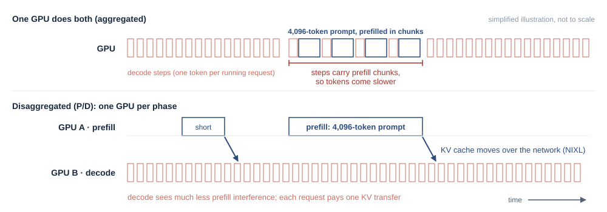

*A simplified illustration. On one GPU, a long prompt is prefilled in chunks that share engine
steps with decoding, so every running request's tokens come more slowly. With P/D, decoding on
GPU B sees much less of that interference, and each request pays one KV-cache transfer instead.*

**What the experiments test:**

1. **Priority.** When batch traffic overloads the pool, do realtime and standard requests
   keep their normal latency?
2. **Fairness.** When one tenant bursts, do the other tenants with the same priority still
   get served promptly?
3. **P/D-aware admission.** Is realtime protected against both prefill-heavy and
   decode-heavy overload?
4. **Tuning.** What does reserving capacity for realtime cost the lower classes?

## How it works

One prefill and one decode vLLM pod, each on its own NVIDIA RTX PRO 6000 (96 GB), plus one
8 vCPU node for the router and the load generator (managed Kubernetes, no RDMA between
the GPU nodes). The llm-d v1.0.0 router sits in front of the pool.

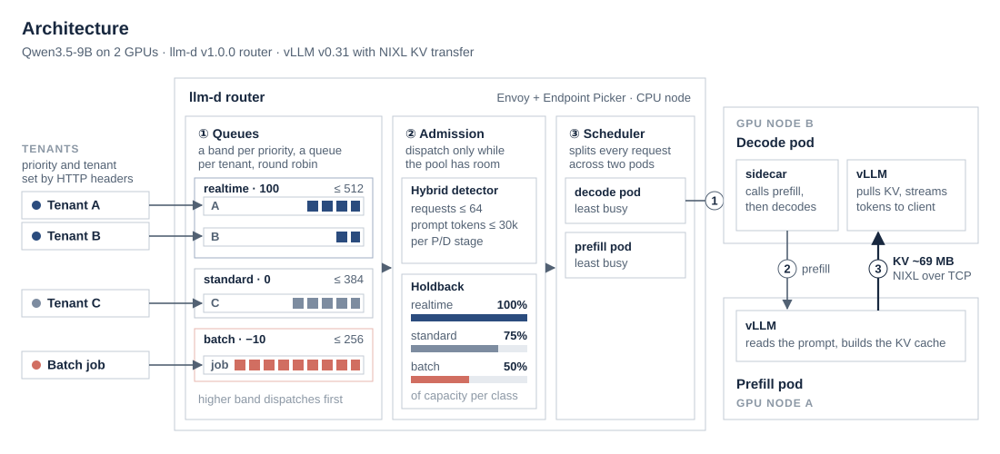

Every request carries two HTTP headers: its class (`x-llm-d-inference-objective`) and its
tenant (`x-llm-d-inference-fairness-id`). The router (Envoy plus llm-d's Endpoint Picker)
handles it in three steps:

1. **Queue.** Each class is a priority band (realtime 100, standard 0, batch −10), and each
   tenant gets its own queue inside its band. The router always serves the highest band that
   has work, and takes turns (round robin) between the tenants inside a band.
2. **Admit.** A request leaves its queue only while the pool has room. A *saturation
   detector* measures how full the pool is. The *hybrid* detector used here counts both
   in-flight requests (limit 64) and in-flight prompt tokens (limit 30,000), the capacity
   measured by calibration. *Priority holdback* then lets the lower classes use only part of
   that capacity: standard up to 75%, batch up to 50%. The rest is always left for realtime.
3. **Schedule.** The router picks a prefill pod and a decode pod. The decode pod's sidecar
   sends the prompt to the prefill pod, pulls the finished KV cache over NIXL, and streams
   the answer back.

Requests that can't be admitted wait in the router, sorted by priority, instead of in
vLLM's single queue. The router rejects a request with HTTP 429 when its band's queue is
full (512 / 384 / 256 requests) or when it has waited 90 s.

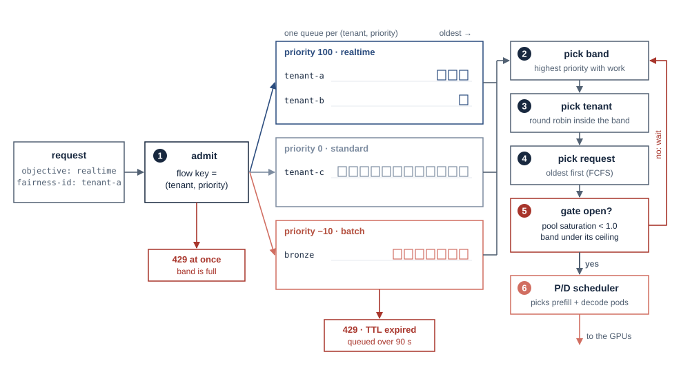

*A request's path through the router. It is admitted into the queue for its (tenant, priority)
pair, or rejected with 429 if that band is full. The dispatcher then picks the highest band
with work, the next tenant in that band (round robin) and its oldest request, and sends it on
only while the gate is open.*

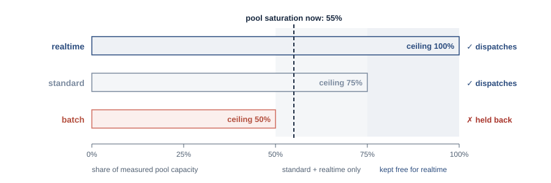

*Priority holdback with this project's ceilings. At 55% pool saturation, realtime and standard
may still dispatch but batch waits. The top 25% of capacity is only ever used by realtime.*

**Metrics.** The main metric is **time to first token (TTFT)** at the 95th
percentile: how long a user waits before the answer starts, for the slowest 5% of requests.
For overloaded tenants the results also report the **share of requests served**, since a rejected
request has no TTFT.

## How it was tested

1. **Calibrate.** A closed-loop sweep with admission limits disabled measures the pool's
   capacity for three request shapes: default (512-token prompt, 128-token answer,
   ~24 req/s), prefill-heavy (4,096 / 32, ~6 req/s) and decode-heavy (256 / 1,024,
   ~4 req/s). The *knee*, where throughput stops growing, becomes the admission limit.
2. **Set each tenant's rate as a fraction of that capacity**, so the scenarios carry over to
   other hardware. Load is open-loop: each tenant sends on a seeded Poisson schedule whether
   or not earlier requests have finished, and latency is measured from the *scheduled* send
   time, so a slow client can't hide queueing.
3. **Run each scenario** as warmup (30 s), surge (120 s, measured) and cooldown (60 s), once
   per router variant. Every variant replays exactly the same arrivals. *Flow control off*
   means the router passes every request straight to vLLM, which queues them in arrival
   order.

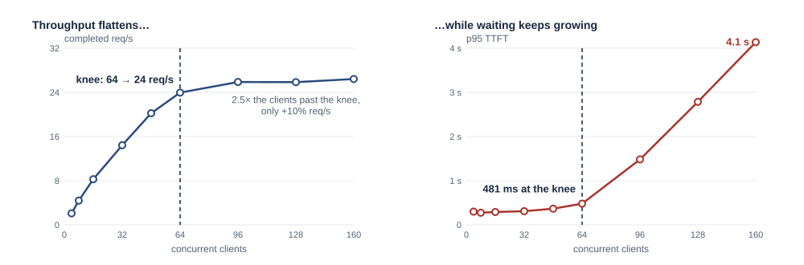

*The calibration sweep for the default shape. Past 64 concurrent requests throughput barely
grows, but p95 TTFT climbs from 0.5 s to 4 s: the extra requests only queue inside vLLM. So 64
became the request limit, and flow control does that queueing instead, in priority order. All
three shapes are in [Pool capacity](#pool-capacity-the-calibration-sweep).*

The load generator runs in a pod on the CPU node, next to the router. It samples the router's
metrics once a second while it sends traffic, and afterwards reads every engine's metrics from
Prometheus, which scrapes the vLLM pods once a second:

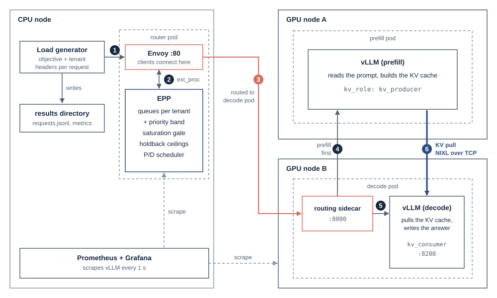

*Where each piece runs. The router sends every request to the decode pod's sidecar, which has
the prefill pod build the KV cache first; decode vLLM then pulls the cache over NIXL (TCP here).*

The four scenarios below each answer one of the questions above. 11 runs in total, about
55 minutes. Scenario definitions are in [pqbench/scenarios/](pqbench/scenarios/), router
variants in [deploy/router/variants/](deploy/router/variants/). The traffic charts are drawn
from the rates each run recorded, and every comparison is one run per configuration.

## Results

### 1. Priority under overload

**Question.** When batch traffic overloads the pool, do realtime and standard requests keep
their normal latency?

**Traffic** (`priority-tiers`). Four tenants, all on the default request shape: Platinum and
Gold (realtime, 15% of capacity each), Silver (standard, 30%) and Bronze (batch, 10%). For
two minutes Bronze surges to 120% of capacity, pushing total demand to 1.8× what the pool
can serve.

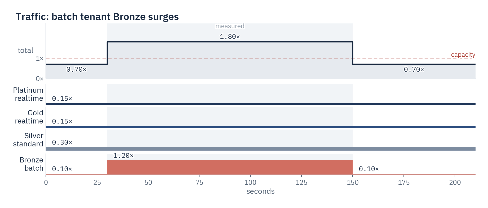

**Compared.** Flow control on vs off.

**Result.** With flow control, Platinum, Gold and Silver stay at ~355 ms p95 through the
surge, about their latency on an idle pool. Bronze absorbs the overload in its own queue: its
requests wait up to the 90 s limit, and 13.5% of its surge is served. Without flow control,
all classes share vLLM's queue and realtime and standard slow to ~1 s. Even then the router
drops 59% of Bronze's surge outright: batch has negative priority, which marks it sheddable
when the pool is saturated.

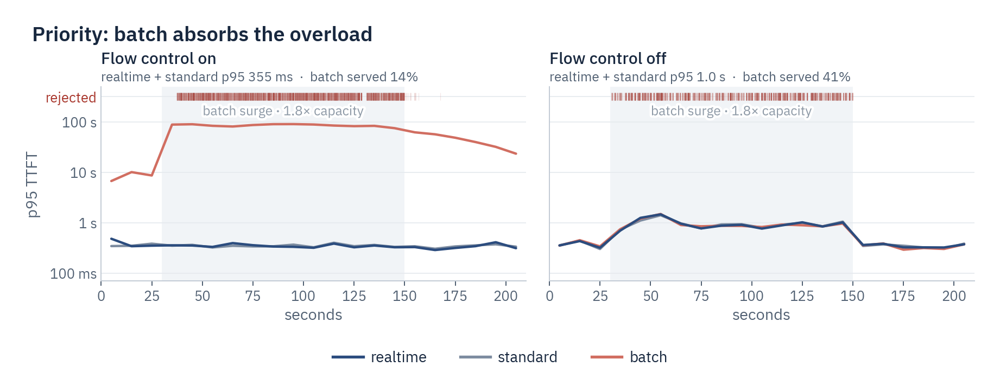

*Lines are each class's p95 TTFT per 10 s window. Rejected requests (HTTP 429 or timeout)
have no TTFT, so each is a faint tick along the top. Realtime
and standard were fully served in both runs; "batch served" is the share of Bronze's surge
that got an answer.*

### 2. Fairness inside a priority band

**Question.** When one tenant bursts, do the other tenants with the same priority still get
served promptly?

**Traffic** (`same-priority-fairness`). Three realtime tenants, A, B and C, at 25% of
capacity each. During the surge A jumps to 140%, more than 5× its normal rate, for a total of
1.9× capacity.

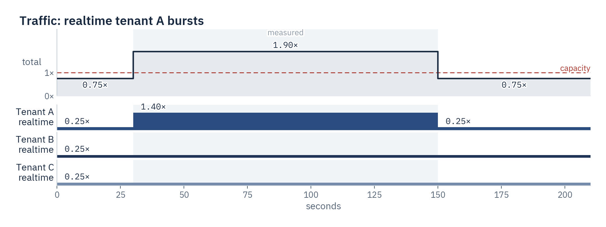

**Compared.** Flow control on vs off.

**Result.** Because each tenant has its own queue and the router takes turns between them, B
and C stay near 0.5 s while A's backlog only delays A (35.6 s). Without flow control the
three share one queue and all of them wait ~78 s.

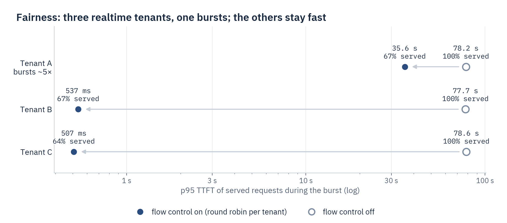

*p95 TTFT of served requests during the burst, and the share of each tenant's burst-phase
requests that were served. Filled: flow control on; hollow: off.*

One catch: queue limits are per priority band, not per tenant. While A's burst filled the
realtime band, about a third of B's and C's requests were rejected with HTTP 429. Clients need
to retry with backoff, or the band must be sized for the expected burst.

### 3. P/D-aware admission

**Question.** Is realtime protected against both prefill-heavy and decode-heavy overload?

**Traffic** (`pd-shapes`). Two surges, each at 1.6× the pool's capacity for that request
shape: first two minutes of prefill-heavy requests (4,096-token prompt, 32-token answer),
then, after a 30 s pause, two minutes of decode-heavy requests (256-token prompt, 1,024-token
answer). A small realtime probe (10% of capacity) runs throughout and shows what an
interactive user would experience.

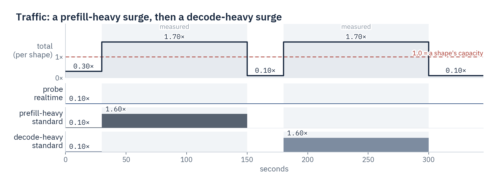

*One lane per tenant, each rate a fraction of its own shape's calibrated capacity (default
23.9 req/s, prefill-heavy 6.1, decode-heavy 4.3), so the total approximates combined load
rather than measuring one shared bottleneck.*

**Compared.** Three saturation detectors: one counting in-flight requests, one counting
in-flight prompt tokens, and the hybrid that counts both.

**Result.** Hybrid kept the realtime probe at ≤ 1.1 s in both surges. Request-only admission
gave 6.7 s during the prefill surge; token-only admission gave 8.7 s during the decode surge.

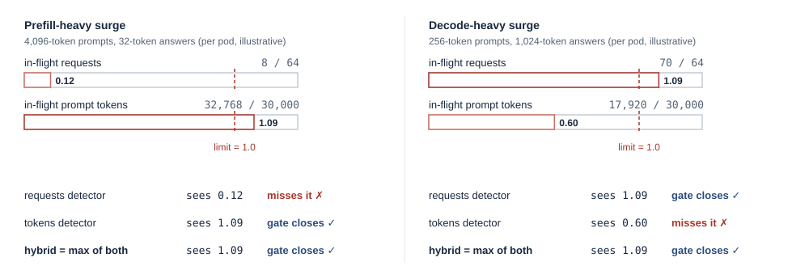

*Why one signal isn't enough, with illustrative per-pod numbers and this project's limits (64
requests, 30,000 prompt tokens). Eight 4,096-token prompts are only 8 requests but 1.09× the
token limit; seventy long answers are 1.09× the request limit but well under the token limit.*

Peak saturation alone can't show when or for how long admission was blocked, so the latency
results support hybrid for this workload rather than prove why each single signal fell short.

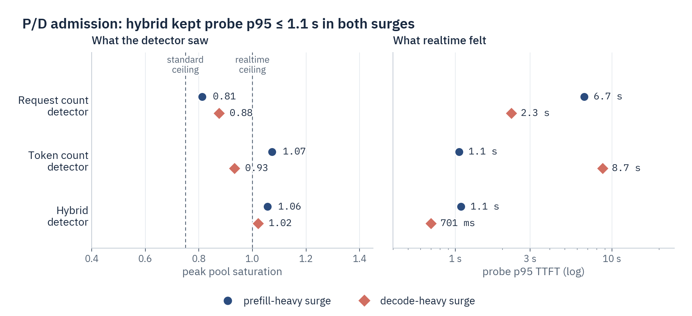

*Left: the highest saturation each detector reported in each surge, against the two dispatch
ceilings: 0.75 for the surging standard tenants and 1.0 for the realtime probe. Every peak
exceeds 0.75, so a peak below 1.0 doesn't mean standard traffic was never held back. Right:
p95 TTFT of the realtime probe's served requests.*

### 4. Admission tuning

**Question.** What does reserving capacity for realtime cost the lower classes?

**Traffic** (`admission-tuning`). Two realtime tenants at 25% of capacity each, and a
standard tenant that surges from 10% to 130%, for a total of 1.8×.

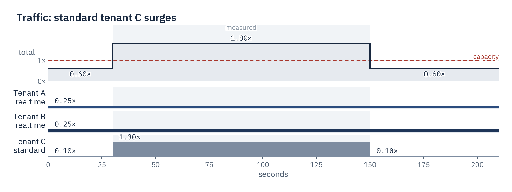

**Compared.** Holdback (the default: standard may use 75% of capacity), no holdback (every
class may use all of it), and the request cap halved from 64 to 32. The `consolidation`
scenario runs the same traffic with the default setting in a separate run; realtime stayed
under 0.5 s there too (360 ms).

**Result.** Holdback gives realtime the lowest latency (420 ms), at the cost of serving less
of the standard surge (39% vs 50% without holdback). Halving the request cap is worse on both
counts: 32 in-flight requests is about what the realtime tenants alone need, so realtime
queues in the router too.

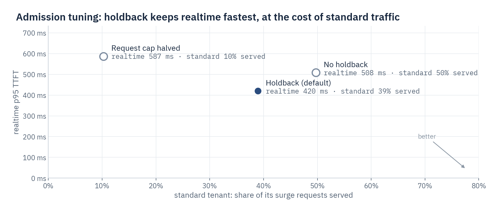

*Each point is one router setting, run against the same traffic. Realtime latency counts served
requests only.*

### Caveats

Each scenario ran once, so differences of a few tens of ms are noise. p95 values near 90 s
are the router's queue time limit, not service time. Full per-tenant tables (TTFT, TPOT,
throughput, success rate, goodput) are in [results/summary.md](results/summary.md), and each
run has a `timeline.png` with latency, throughput, queue depth, saturation and vLLM state over
time (for example [consolidation](results/consolidation/hybrid/rep1/timeline.png)).

## Below the router

The scenarios test the router. Underneath it, the pool's capacity comes from the GPUs and,
with P/D, from the network between them.

### Pool capacity: the calibration sweep

The sweep raises the number of concurrent clients step by step, with admission limits
disabled, once per request shape. Each shape hits a different limit:

| Shape (prompt / answer tokens) | Capacity at the knee | What limits it |
|---|---|---|
| default (512 / 128) | 23.9 req/s at 64 in flight | KV transfer between the GPUs ([next section](#moving-the-kv-cache)); prefill tensor cores are only 28–34% busy |
| prefill-heavy (4,096 / 32) | 6.1 req/s at 8 in flight | prefill compute (tensor cores 76% busy); past 16 in flight, throughput *falls*, to 5.6 req/s at 64 |
| decode-heavy (256 / 1,024) | 4.3 req/s at 96 in flight | the decode batch: time per output token doubles, from 13 ms at 8 in flight to 26 ms at 160 |

The router's admission limits come from these knees: 64 in-flight requests (the default
shape's knee) and 30,000 in-flight prompt tokens (about the prefill-heavy knee times its
prompt length).

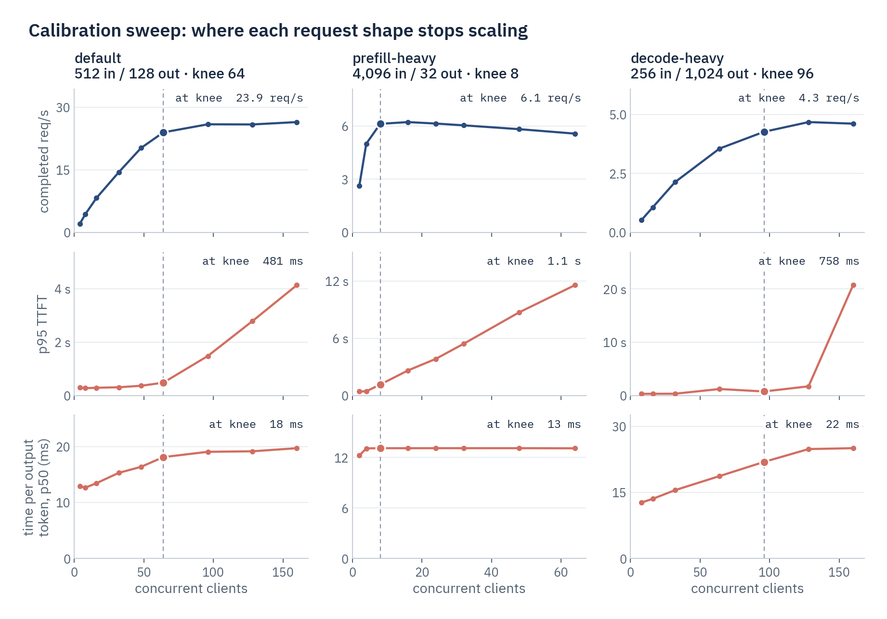

*One column per shape. Rows: completed requests per second, p95 TTFT and median time per
output token. The dashed line and the large dot mark the knee; the corner label gives the
value there. Token throughput and other percentiles are in
[sweep_summary.csv](results/calibration/sweep_summary.csv).*

### Moving the KV cache

With UCX's default settings, a fixed 48-client probe reached only 4.9 req/s at 9.6 s p95 TTFT
(all runs above use the fix below). The bottleneck was the KV-cache transfer between the two
GPU nodes.
Qwen3.5-9B mixes linear-attention layers (with a 2 MiB state each) and attention layers, and
vLLM gives every layer the same page size, so each request moves ~69 MB, even for a short
prompt. Without RDMA, UCX sends it over TCP in small segments, each staged through host
memory.

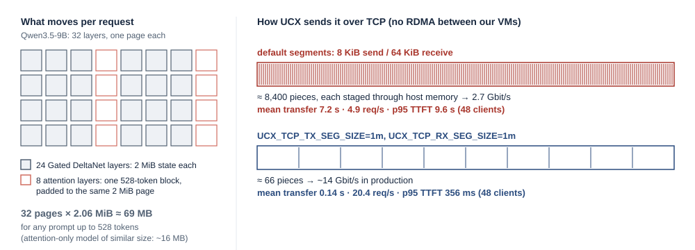

Raising UCX's TCP segment size to 1 MiB (`UCX_TCP_TX_SEG_SIZE` / `UCX_TCP_RX_SEG_SIZE`) cut
the mean transfer from 7.2 s to 0.14 s:

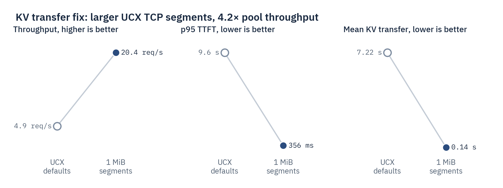

*A fixed probe: 48 concurrent clients, 512-token prompts, 60 s, before (hollow) and after
(filled) the change.*

The next limit is one receive thread draining one TCP connection, at ~15–17 Gbit/s. NIXL can
split a transfer across threads (measured up to ~25 Gbit/s), but vLLM v0.31 doesn't pass that
setting through yet.

## Takeaways for running llm-d flow control

- **Calibrate before setting limits.** The admission limits are the pool's knee, which depends
  on the model, the GPUs and the network. Rerun the sweep on new hardware
  ([how](#calibrating-for-different-hardware)).
- **Use the hybrid detector when prompt and answer lengths vary.** Request counts miss long
  prompts and token counts miss long answers; only hybrid protected realtime in both surges.
- **Size each band's queue for its bursts, or retry.** Queue limits are per band, so one
  tenant's burst fills the band and every tenant in it gets 429s. Allow about rate × queue
  time limit (≈ 1,500 requests here, against 512), and have clients retry 429s with backoff.
- **Holdback is the knob for protecting realtime.** Reserving the top 25% of capacity gave
  realtime its lowest latency, at the cost of lower-priority throughput.
- **Keep the request cap above the top tier's own demand.** Halved to 32, it made realtime
  queue in the router too.
- **Batch is dropped, not queued, even with flow control off.** Negative priority marks
  requests sheddable when the pool is saturated; give batch clients retries if that matters.
- **Check the network under P/D.** Without RDMA, moving the KV cache, not the GPUs, set the
  pool's capacity; raise UCX's TCP segment size first.

## Run it yourself

**Cluster:** Kubernetes ≥ 1.33 with two GPU nodes (one NVIDIA GPU each, exposed as
`nvidia.com/gpu`), one CPU node (8 vCPU / 32 GB) and a StorageClass with ReadWriteMany
access for the shared weight cache (without one, see [Weights](#weights-replicas-and-tensor-parallelism)).
**Tools:** `kubectl`, `helm` ≥ 3.14, Python ≥ 3.14.

### 1. Install the dependencies

Gateway API Inference Extension and llm-d CRDs, and LeaderWorkerSet (provides `DisaggregatedSet`):

```bash
kubectl apply -f https://github.com/kubernetes-sigs/gateway-api-inference-extension/releases/download/v1.6.2/v1-manifests.yaml
kubectl apply -f https://github.com/llm-d/llm-d-router/releases/download/v1.0.0/manifests.yaml
```

```bash
helm pull oci://registry.k8s.io/lws/charts/lws --version 1.0.0 --untar --untardir /tmp/lws
kubectl apply --server-side --force-conflicts -f /tmp/lws/lws/crds
helm upgrade --install lws oci://registry.k8s.io/lws/charts/lws --version 1.0.0 \
  -n lws-system --create-namespace --set enableDisaggregatedSet=true --wait
```

Prometheus (kube-prometheus-stack). It scrapes every vLLM pod once a second; `pqbench` reads
the per-pod engine metrics from it after each run, and Grafana shows the run live:

```bash
helm upgrade --install kps kube-prometheus-stack \
  --repo https://prometheus-community.github.io/helm-charts --version 75.15.1 \
  -n monitoring --create-namespace -f deploy/kube-prometheus-stack.values.yaml --wait
```

### 2. Deploy the model servers and the router

```bash
helm upgrade --install pd-pool charts/pd-pool -n priority-queue --create-namespace
```

The commands here use release names `pd-pool` (model servers) and `priority-queue` (router).
With other names, pass the router's to pd-pool as `--set router.releaseName=...`, and change
the Service names in the port-forward commands below.

```bash
VARIANT=hybrid
helm upgrade --install priority-queue \
  oci://ghcr.io/llm-d/charts/llm-d-router-standalone --version v1.0.0 -n priority-queue \
  -f https://raw.githubusercontent.com/llm-d/llm-d/v1.0.0/guides/recipes/router/base.values.yaml \
  -f deploy/router/values.yaml \
  --set-file "router.epp.pluginsCustomConfig.custom-plugins\.yaml=deploy/router/variants/$VARIANT.yaml" \
  --set-string "router.epp.podAnnotations.router-variant=$VARIANT" --wait
```

To switch router variants later (`no-flow-control`, `requests`, `tokens`, `no-holdback`,
`cap-tight`), rerun this command with a different `VARIANT`.

#### Weights, replicas and tensor parallelism

All model-server pods share one ReadWriteMany PVC (`pd-pool-model-cache`), so adding replicas
or rolling out a new revision doesn't download the model again. Set the class with
`persistence.storageClass`. On a cluster without ReadWriteMany storage, pass
`--set persistence.enabled=false`: each pod then downloads into its own `emptyDir` at
start, as the upstream llm-d guides do. Pin `model.revision` to a commit SHA so every pod
serves the same files.

Each role scales on its own. Every replica is one vLLM engine with `tensorParallelSize` GPUs:

```bash
# Four decode engines on one GPU each:
helm upgrade pd-pool charts/pd-pool -n priority-queue --reset-then-reuse-values \
  --set decode.replicas=4
# One decode engine on four GPUs (TP4):
helm upgrade pd-pool charts/pd-pool -n priority-queue --reset-then-reuse-values \
  --set decode.tensorParallelSize=4
```

Decode TP must be at least prefill TP: vLLM's NIXL connector only fans out (prefill TP1 to
decode TP4), and the chart rejects the reverse. When the two TPs differ, check that both
engines log the same KV block size. Qwen3.5's hybrid attention picks it from the per-GPU
state size, so pin `--block-size` in `modelServers.args` if they disagree. Like upstream, the
chart adds no placement rule: prefill and decode may share a node, which only makes the KV
transfer shorter. Use `prefill.affinity` / `decode.affinity` to pin or spread a role. The
published runs had one GPU per node, so there KV always crossed the network.

The first start downloads the weights and compiles the model, which takes several minutes.
A Job (`pd-pool-download-*`) fills the shared weight cache once; the model servers wait for
it, then load from the cache:

```bash
kubectl -n priority-queue wait --for=condition=Ready pod -l llm-d.ai/role --timeout=45m
```

### 3. Connect and check the P/D split

`pqbench` runs on your machine and reaches the cluster through port-forwards: the router
(and its metrics) and Prometheus. Keep them running while you benchmark. Switching router
variants replaces the router pod, which ends its port-forward, so that one reconnects in a
loop:

```bash
while true; do
  kubectl -n priority-queue port-forward svc/priority-queue-epp 8080:80 9090:9090; sleep 2
done &
kubectl -n monitoring port-forward svc/kps-prometheus 9091:9090 &
```

Send a request through the router:

```bash
curl -sS http://localhost:8080/v1/completions -H "Content-Type: application/json" \
  -H "x-llm-d-inference-objective: realtime" -H "x-llm-d-inference-fairness-id: tenant-a" \
  -d '{"model": "Qwen/Qwen3.5-9B", "prompt": "What is prefill/decode disaggregation?", "max_tokens": 32}'
```

The prefill engines' request counter should go up with each request; if it doesn't, decode
served the request alone:

```bash
curl -s http://localhost:9091/api/v1/query \
  --data-urlencode 'query=sum by (llm_d_ai_role) (vllm:request_success_total)'
```

### 4. Run a scenario

```bash
pip install -e '.[analysis]'
pqbench run --scenario priority-tiers --variant hybrid
```

The run takes about 4 minutes and writes to `results/priority-tiers/hybrid/rep1/`. `pqbench`
reads the pool's capacity from the committed `results/calibration/calibration.json` and
talks to the port-forwards above (override with `--router`, `--epp-metrics`, `--prometheus`
or `PQ_*` variables). Repeat for each scenario and each router variant it compares (listed under
[Results](#results), and by `pqbench scenarios`), switching the router to that variant
first.

### 5. Analyze

```bash
pqbench report results
```

This writes `results/summary.md`, per-scenario CSVs, timelines and figures.

### Optional: run next to the router

From a laptop, every TTFT includes the network round trip to the cluster, and
`kubectl port-forward` isn't built for the heaviest scenarios (~40 req/s of streamed
responses). The published numbers were measured from inside the cluster. To do the same,
start a pod from the `pqbench` image in the router's namespace, copy the calibration in, and
run the same commands there:

```bash
kubectl -n priority-queue run pqbench --image=ghcr.io/d-nyamkhuu/pqbench:latest --restart=Never \
  --env=PQ_ROUTER=http://priority-queue-epp \
  --env=PQ_EPP_METRICS=http://priority-queue-epp:9090/metrics \
  --env=PQ_PROMETHEUS=http://kps-prometheus.monitoring:9090 \
  --env=PQ_CALIBRATION=/work/calibration.json \
  --command -- sleep infinity
kubectl -n priority-queue wait --for=condition=Ready pod/pqbench
kubectl -n priority-queue cp results/calibration/calibration.json pqbench:/work/calibration.json
```

```bash
kubectl -n priority-queue exec pqbench -- pqbench run --scenario priority-tiers --variant hybrid
```

Copy the results out when you're done (they merge into `./results`), then delete the pod:

```bash
kubectl -n priority-queue cp pqbench:/work/results results
kubectl -n priority-queue delete pod pqbench
```

### Calibrating for different hardware

The committed limits fit 2 × RTX PRO 6000. On other GPUs, deploy the router with
`VARIANT=calibrate` (limits disabled) and run a sweep (~30 min). The sweep measures
throughput with a fixed number of clients, so client latency skews it: run it from the
in-cluster pod if you can.

```bash
pqbench sweep
pqbench calibrate results/calibration
```

Copy `max_concurrency` and `max_token_concurrency` from `results/calibration/calibration.json`
into `concurrency-detector` in [deploy/router/epp.yaml](deploy/router/epp.yaml), then
rerun `deploy/router/render-variants.sh` ([router variants](#router-variants)).

### Optional: live Grafana dashboard

Add `--set router.monitoring.prometheus.enabled=true` to the router command (so Prometheus
also scrapes the EPP), then open Grafana (login `admin` / `priority-queue`) and the *llm-d flow control on P/D* dashboard:

```bash
kubectl -n monitoring port-forward svc/kps-grafana 3000:80
```

### Clean up

```bash
helm uninstall pd-pool priority-queue -n priority-queue
kubectl -n priority-queue delete pvc pd-pool-model-cache
```

The weight cache outlives `helm uninstall` (so a reinstall skips the download) and needs
deleting by hand.

## Repository layout

| Component | Where |
|---|---|
| Router config (P/D scheduling + flow control in one file) | [deploy/router/epp.yaml](deploy/router/epp.yaml) |
| Model servers (`DisaggregatedSet`), traffic classes, volumes, Grafana dashboard | [charts/pd-pool/](charts/pd-pool/) |
| Load generator, analysis and figures (Python, HTTP only) | [pqbench/](pqbench/) |
| Container image, for running pqbench inside the cluster | [Dockerfile](Dockerfile) |

## Development

```bash
pip install -e '.[dev]'
ruff check . && ruff format --check .
pytest
helm lint charts/pd-pool
```

`pytest` includes end-to-end runs against a fake pool, so no GPU is needed. The `pqbench`
image ([Dockerfile](Dockerfile)) is published to `ghcr.io/d-nyamkhuu/pqbench` when a `v*` tag
is pushed.

### Router variants

The router configs in [deploy/router/variants/](deploy/router/variants/) are prebuilt and
committed: install one with `--set-file` as in step 2, no build step. Each is
[epp.yaml](deploy/router/epp.yaml) with one yq expression from
[variants.yaml](deploy/router/variants.yaml) applied. After editing either of those, rerun
[render-variants.sh](deploy/router/render-variants.sh) (needs
[yq](https://github.com/mikefarah/yq) v4) and commit the result; CI reruns it and fails if the
committed files differ.

## Built on

[llm-d](https://github.com/llm-d/llm-d) v1.0.0 (router, P/D disaggregation and flow-control
guides), [vLLM](https://github.com/vllm-project/vllm) v0.31 with NIXL, and
[LeaderWorkerSet](https://github.com/kubernetes-sigs/lws). The combined P/D + flow-control
router config started from the recipe in
[alexagriffith/flow-control-benchmarks](https://github.com/alexagriffith/flow-control-benchmarks)
and was recalibrated for this model and hardware.

## License

[MIT](LICENSE)
